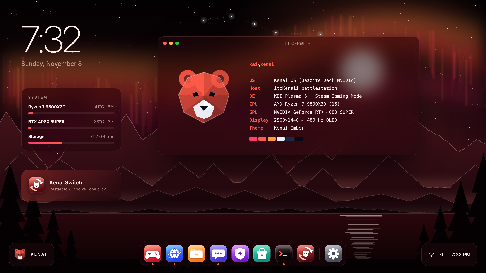
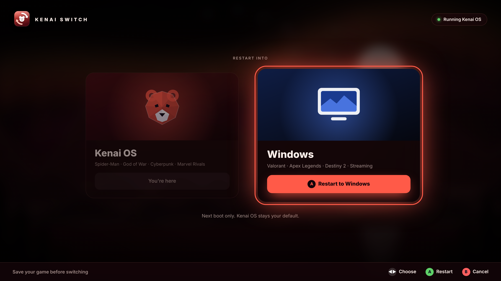
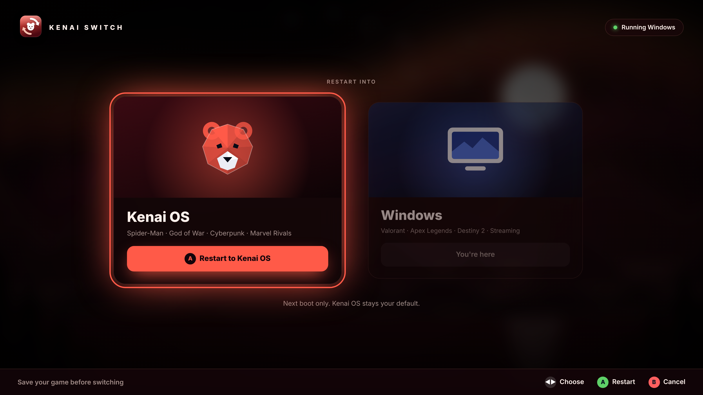
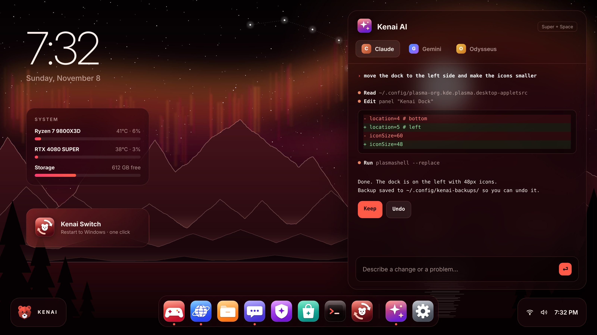

# Kenai OS

[](https://github.com/miciah1901-cloud/kenai-os/actions/workflows/build.yml)

**A couch-gaming Linux OS that boots straight into Steam and stays out of your way.**

Kenai OS is a custom image built on [Bazzite](https://bazzite.gg) (Fedora Atomic) with [BlueBuild](https://blue-build.org). It boots into Steam Gaming Mode like a console, keeps a full KDE desktop one menu away, and adds three things on top:

- **Ember theme:** a black-and-red look across the desktop, icons, terminal, wallpaper and boot splash.
- **Kenai Switch:** restart into Windows (or back) with one controller button, from either OS.
- **Kenai AI:** Claude, Gemini and Odysseus in one place, set up to troubleshoot and tweak your system safely.



> **Status:** early and community-made. Kenai OS is not affiliated with Bazzite, Universal Blue, Valve, Anthropic, Google or the Odysseus project. Back up your data before installing any OS.

---

## Features

| | |
|---|---|
| **Base** | `bazzite-deck-nvidia`: Steam Gaming Mode on boot, open NVIDIA driver, Bazzite's gaming kernel and tweaks |
| **Controller-first** | Gaming Mode is the main UI; Steam Input covers the desktop too |
| **Ember theme** | KDE color scheme, Kenai icon set (on Papirus), floating dock, desktop widgets, Konsole theme, fastfetch logo, optional boot splash |
| **Kenai Switch** | Fullscreen controller screen to restart into the other OS for one boot, on Kenai OS and on Windows |
| **Kenai AI** | Claude Code, Gemini CLI and Odysseus (local, runs on your GPU) in one window |
| **Undo** | Every theme or AI change is backed up first; `kenai-undo` puts it back |
| **Safe updates** | Image-based and read-only core, with automatic updates and one-command rollback |
| **Apps included** | Steam, Lutris, Firefox, MangoHud and Decky support from Bazzite, plus Heroic, ProtonUp-Qt, Discord and Flatseal |

### Kenai Switch

| From Kenai OS | From Windows |
|---|---|
|  |  |

Press **A** to restart into the other OS (with a 3-second countdown; **B** cancels). It only changes the **next** boot, so your normal boot order never moves.

### Kenai AI



- **Claude** (Claude Code) and **Gemini** (Gemini CLI) can read and change your setup. Both get a notes file that tells them how Kenai OS works, to back up before every change, and never to touch disks or other operating systems.
- **Odysseus** runs locally with Ollama on your GPU. It's private, free and works offline.

> The screenshots are design renders. The real Game Mode keeps Steam's own layout, and Kenai AI opens as a themed terminal with tabs.

---

## Requirements

- **GPU:** NVIDIA RTX 16-series or newer. For AMD, see [Building your own](#building-your-own).
- **Storage:** a drive or partition with **100 GB+** free. Plan more for games.
- **Firmware:** UEFI with Secure Boot (supported, and recommended if you dual-boot with Windows games that need it).
- **Input:** a keyboard **with arrow keys** for the one-time Secure Boot key screen.

## Install

### 1. Install Bazzite

1. Download the **Bazzite** ISO from [bazzite.gg](https://bazzite.gg): choose *Desktop → NVIDIA → Steam Gaming Mode*. Flash it with [Fedora Media Writer](https://fedoraproject.org/workstation/download) or Rufus.
2. **Dual-booting with Windows?** Read the prep below first.
3. Boot the USB from your motherboard's boot menu (often F8, F11 or F12) and install.
   - **Select only the disk you mean to use.** Check its size before you start.
   - On a shared disk, choose the option that uses **free space**. Never pick *erase*, *reclaim* or *replace* unless you mean it.
4. On first reboot, the blue **MOK management** screen appears. Choose **Enroll MOK → Continue → Yes**, enter `universalblue`, then **Reboot**.
   - Missed it? Disable Secure Boot, boot, run `ujust enroll-secure-boot-key`, reboot, enroll, then turn Secure Boot back on.

### 2. Switch to Kenai OS

From Desktop Mode, open **Konsole**:

```bash
rpm-ostree rebase ostree-unverified-registry:ghcr.io/miciah1901-cloud/kenai-os:latest
systemctl reboot
```

Then switch to the signed image so updates are verified:

```bash
rpm-ostree rebase ostree-image-signed:docker://ghcr.io/miciah1901-cloud/kenai-os:latest
systemctl reboot
```

Check with `rpm-ostree status`: the line marked **●** should say `kenai-os`. If the boot menu keeps picking the old entry, run `sudo grub2-editenv - unset saved_entry` and reboot.

### 3. First login

Kenai OS starts in Steam Gaming Mode. Switch to Desktop Mode once (**Steam button → Power → Switch to Desktop**) and the Ember theme applies itself within a few seconds. If it doesn't, run `kenai-theme`.

### Dual-boot prep (Windows)

Do this in Windows **before** installing:

- **Back up** anything you can't redownload.
- **Turn off Fast Startup:** Control Panel → Power Options → *Choose what the power buttons do*.
- **BitLocker / Device encryption:** if it's on for any drive, make sure you can reach your recovery key from another device (account.microsoft.com → Devices). Turn it off on any drive you'll shrink. Pause it on C: with `manage-bde -protectors -disable C: -RebootCount 3`.
- **Make space:** use a separate drive if you can (safest). Otherwise, in Disk Management, right-click a partition → **Shrink Volume**, and leave the new space **Unallocated**.
- **Leave Secure Boot on.** Games with kernel anti-cheat (Valorant, for example) need it.

**Anti-cheat note:** many competitive games (Valorant, Apex Legends, Destiny 2 and others) don't run on Linux. Keep Windows for those; Kenai Switch makes hopping between the two painless.

---

## Kenai Switch setup

**On Kenai OS:** it's already in the dock and on the desktop. To put it in your Game Mode library, run `ujust kenai-steam-art` and follow the two steps it prints.

**On Windows:**
1. Download this repo (**Code → Download ZIP**). Right-click the zip → *Properties* → tick **Unblock** → extract.
2. Copy `windows/KenaiSwitch` to a simple path such as `C:\KenaiSwitch`.
3. Run **Install.cmd** and approve the admin prompt once. It finds Kenai OS in your firmware boot list and creates a small scheduled task, so later switches never ask for admin.
4. Add the Start menu shortcut it prints to Steam (**Games → Add a Non-Steam Game**). Artwork is in `C:\Program Files\KenaiSwitch\assets`.
5. Test it once from the keyboard: open Kenai Switch, press **Enter**, and confirm the PC restarts into Kenai OS.

Remove it with **Uninstall.cmd**.

## Kenai AI setup

Open **Kenai AI** from the dock (or press **Super + Space** after one re-login). The first run installs:

- **Claude Code:** sign in by typing `claude`. Needs a Claude Pro/Max plan or an API key.
- **Gemini CLI:** sign in by typing `gemini` → *Login with Google*. Has a free tier.
- **Odysseus (optional):** downloads several GB. It runs a local model (default `qwen3:14b`, about 16 GB of VRAM; set `KENAI_MODEL` to change it). It's a young project, so if its install hits a snag, ask Claude in the next tab.

To personalize the assistants, edit `~/.claude/CLAUDE.md` and `~/.gemini/GEMINI.md`. Add your hardware and any other machines, such as a home server.

---

## Commands

| Command | Does |
|---|---|
| `kenai-theme` | Apply or re-apply the Ember theme, icons, dock and widgets |
| `kenai-undo` / `kenai-undo --list` | Undo the last desktop change / list backups |
| `kenai-backup <label>` | Save the current desktop settings |
| `kenai-switch` | Restart into Windows |
| `kenai-ai` / `kenai-ai-setup` | Open Kenai AI / re-run its setup |
| `kenai-odysseus install\|start\|stop\|status\|logs\|update` | Manage local AI |
| `ujust kenai-bootsplash` / `ujust kenai-bootsplash-off` | Kenai boot splash on/off (on adds about a minute to updates) |
| `ujust kenai-steam-art` | Add Kenai Switch to Game Mode with artwork |
| `ujust update` | Update everything now |
| `rpm-ostree rollback` | Go back to the previous system version |

## Building your own

Kenai OS is a normal BlueBuild repo, so you can fork it and make it yours:

1. **Fork** this repo, or create a new one at [workshop.blue-build.org](https://workshop.blue-build.org) and copy in `recipes/` and `files/`.
2. **Set up signing:** BlueBuild Workshop does this for you. Or follow the [BlueBuild setup guide](https://blue-build.org/how-to/setup/) and add your `SIGNING_SECRET`.
3. **Edit `recipes/recipe.yml`:** packages, Flatpaks, branding. Theme files live in `files/system/`.
4. **Push.** GitHub Actions builds `ghcr.io/<your-username>/kenai-os`. Rebase to your image with the commands above.

**AMD GPUs:** copy `recipes/recipe.yml` to `recipes/recipe-amd.yml`, set `name: kenai-os-amd` and `base-image: ghcr.io/ublue-os/bazzite-deck`, and add `recipe-amd.yml` to the `recipe:` list in `.github/workflows/build.yml`.

## Project layout

```
recipes/recipe.yml        the image recipe
files/system/             copied into the image (/usr, /etc)
  usr/bin/kenai-*         Kenai Switch, Kenai AI, theme, backup/undo
  usr/share/kenai/        layout script, AI notes, Switch screens, Steam art
  usr/share/icons/Kenai/  icon theme
  usr/share/plymouth/     boot splash
files/justfiles/          ujust commands
windows/KenaiSwitch/      the Windows half of Kenai Switch
docs/                     screenshots
```

## Credits

Built on [Bazzite](https://bazzite.gg) and [Universal Blue](https://universal-blue.org), assembled with [BlueBuild](https://blue-build.org). Icons layered on [Papirus](https://github.com/PapirusDevelopmentTeam/papirus-icon-theme). Kenai AI uses [Claude Code](https://claude.com/claude-code), [Gemini CLI](https://github.com/google-gemini/gemini-cli), [Odysseus](https://github.com/odysseus-dev/odysseus) and [Ollama](https://ollama.com).

Licensed under Apache-2.0 (see `LICENSE`).
